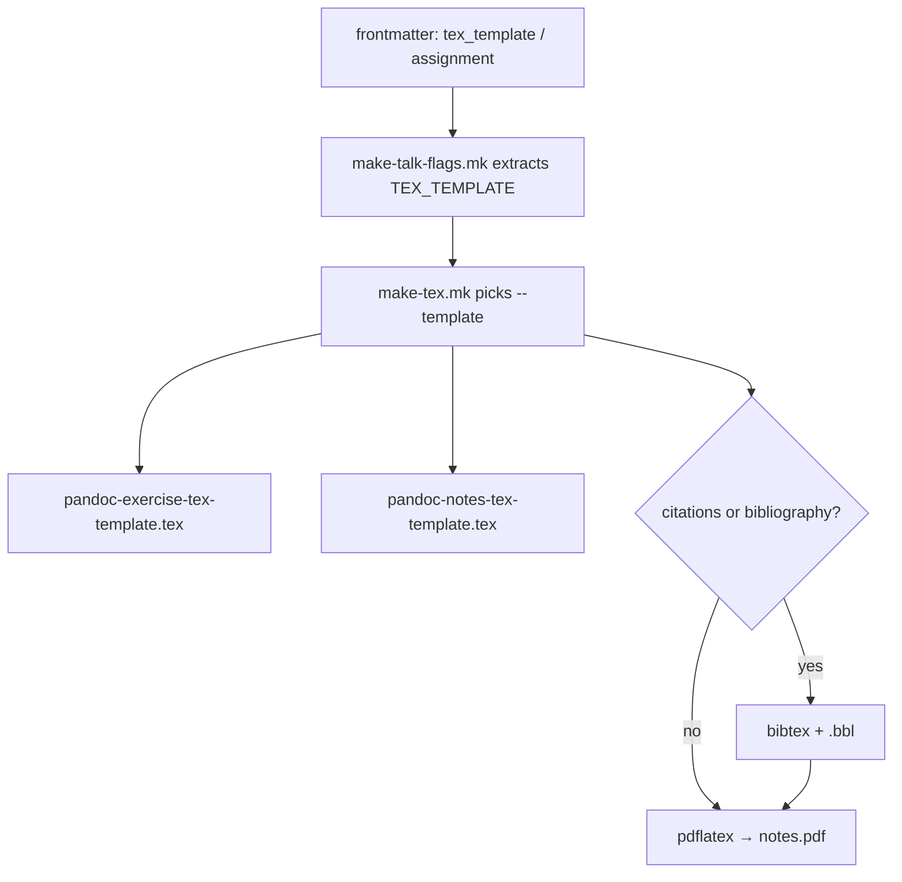

# CIP-0013: Exercise-sheet LaTeX template for notes PDF

> **Note**: CIPs describe HOW to achieve requirements (WHAT).
> Use `related_requirements` to link to the requirements this CIP implements.

## Status

- [x] Proposed - Initial idea documented
- [x] Accepted - Approved, ready to start work
- [x] In Progress - Actively being implemented
- [x] Implemented - Work complete, awaiting verification
- [ ] Closed - Verified and complete
- [ ] Rejected - Will not be implemented (add reason, use superseded_by if replaced)
- [ ] Deferred - Postponed (use blocked_by field to indicate blocker)

## Summary

Add a lean pandoc LaTeX template for **exercise / worksheet** notes PDFs, and let authors select it from frontmatter. Keep the existing `pandoc-notes-tex-template.tex` as the default for lecture notes. Stop forcing bibtex when there are no citations.

Addresses [REQ-0011](../requirements/req0011_exercise-sheet-pdf.md).

## Motivation

Worksheet 1 in IEI (`assignment: True`, `notespdf: True`) currently compiles through `make-tex.mk` with a single hardcoded template:

```makefile
--template ${TEMPLATESDIR}/pandoc/pandoc-notes-tex-template.tex
```

That template is a heavy pandoc-derived `article`: `lipsum`, `titlesec`, `fixltx2e`, duplicate `amssymb`, `\maketitle` plus a misused `\abstract{...}` command, and always-on `--natbib` / bibtex. The result looks like a bad exercise sheet and fails the make chain when there are no `\citation`s (empty `.bbl`).

Separately, `assignment: True` only flips GPP macros (`\writeassignment`, question titles). It does **not** change the PDF chrome. Authors need an explicit, small layout path for printable handouts.

## Detailed Description

### Design choices

| Concern | Decision |
|---------|----------|
| New template file | `lamd/templates/pandoc/pandoc-exercise-tex-template.tex` |
| Selection field | Frontmatter `tex_template: notes \| exercise` (default `notes`) |
| Convenience | If `tex_template` unset and `assignment: true`, use `exercise` for notes PDF |
| Lecture notes | Unchanged when `tex_template` is `notes` or absent without `assignment` |
| Bibliography | Pass `--natbib` / run bibtex only when bibliography metadata or citations warrant it; otherwise skip `.bbl` dependency |
| Header content | Title; optional week / practical / released / due (`date`); author; one-line candidate field; brief from `abstract` as ordinary prose, not `\abstract{}` |
| Packages | Minimal: `geometry`, `amsmath`/`amssymb` once, `hyperref`, `enumitem`, `graphicx`, `parskip`; no `lipsum`, no `titlesec`, no `fixltx2e` |

### Alternatives considered

1. **Reuse `assignment` alone to switch templates** — works for IEI, but conflates “this source has marked questions” with “use exercise chrome.” Explicit `tex_template` is clearer; convenience mapping covers current worksheets.
2. **Custom document class (`.cls`)** — heavier packaging and install story; pandoc template is enough for v1.
3. **Patch the existing notes template** — would change all lecture-note PDFs; reject for this CIP.

### Plumbing



Concrete makefile sketch:

```makefile
# make-talk-flags.mk — extract with other fields
TEX_TEMPLATE:=$(shell grep '^tex_template:' $(_FIELDS_CACHE) | sed 's/^tex_template://')
ifeq ($(strip $(TEX_TEMPLATE)),)
  ifeq ($(ASSIGNMENT),True)
    TEX_TEMPLATE:=exercise
  else
    TEX_TEMPLATE:=notes
  endif
endif
NOTES_TEX_TEMPLATE:=${TEMPLATESDIR}/pandoc/pandoc-$(TEX_TEMPLATE)-tex-template.tex

# make-tex.mk
${BASE}.notes.tex: ${BASE}.notes.tex.markdown
	pandoc -s \
		--template ${NOTES_TEX_TEMPLATE} \
		--number-sections \
		$(if $(BIBFLAGS),--natbib ${BIBFLAGS},) \
		-B ${INCLUDESDIR}/${NOTATION} \
		-o ${BASE}.notes.tex \
		${BASE}.notes.tex.markdown
```

Bibtex skip: either (a) make `${BASE}.notes.pdf` depend on `.bbl` only when the `.aux` contains `\citation`, or (b) emit a stub `.bbl` / omit `\bibliography` from the exercise template when `$bibliography$` is empty. Prefer (b) in the exercise template plus a makefile guard so lecture notes stay on the current path until separately cleaned up.

### Template layout (v1)

```
┌─────────────────────────────────────────────┐
│ Module / venue (optional)     Week N · Due  │
│ TITLE                                       │
│ Author                                      │
│ Candidate number: _______________           │
├─────────────────────────────────────────────┤
│ Brief (from abstract, plain paragraph)      │
├─────────────────────────────────────────────┤
│ Body (sections, lists, maths)               │
└─────────────────────────────────────────────┘
```

Pandoc variables to honour when present: `title`, `author`, `date`, `abstract`, `week`, `practical`, `released`, `venue`, `geometry`, `fontsize`, `papersize`. Module code can come later from `_lamd.yml` if exposed to pandoc metadata; not required for v1.

### Consumer (IEI) once Accepted

In `_lamd/intro-history-entropy-shannon-practical.md` (and later worksheets):

```yaml
assignment: True
notespdf: True
tex_template: exercise   # optional if convenience mapping is enough
```

No content rewrite required beyond what already compiles.

### Out of scope

- Redesigning HTML practical pages.
- Exam-class features (cover sheets, multi-version papers).
- Changing `\writeassignment` / exercise GPP macros.
- Full cleanup of cruft inside `pandoc-notes-tex-template.tex` (separate CIP if desired).

## Implementation Plan

1. **Land the template** — add `pandoc-exercise-tex-template.tex` (draft already in tree for review).
2. **Wire selection** — extract `tex_template` in `make-talk-flags.mk`; resolve default; use in `make-tex.mk`.
3. **Bibliography guard** — exercise template omits bibliography block when unused; makefile does not require `.bbl` when there are no citations (at least for `TEX_TEMPLATE=exercise`).
4. **Docs** — short note in `docs/contexts/notes.md` (or teaching context) documenting `tex_template` and the `assignment` convenience.
5. **Validate** — rebuild IEI Worksheet 1 notes PDF; confirm lecture notes still use the notes template.
6. **Optional IEI frontmatter** — set `tex_template: exercise` explicitly for clarity.

## Backward Compatibility

- Default remains the current notes template.
- Sources with only `assignment: True` will **switch** to the exercise template under the convenience rule. That is intentional for worksheets; authors who want assignment macros *and* lecture-note chrome set `tex_template: notes`.
- No change to HTML / slides / ipynb outputs.

## Testing Strategy

- Fixture markdown with `assignment: True`, `notespdf: True`, no citations → builds PDF without bibtex error; header shows title / due / candidate line.
- Fixture with `tex_template: notes` and `assignment: True` → still uses notes template.
- Existing lecture notes smoke build unchanged.
- Manual check: IEI `intro-history-entropy-shannon-practical.md`.

## Related Requirements

- [REQ-0011](../requirements/req0011_exercise-sheet-pdf.md) — lean exercise-sheet PDFs from LaMD sources.

## Implementation Status

- [x] Draft CIP and REQ-0011
- [x] Draft `pandoc-exercise-tex-template.tex` for review
- [x] Accept CIP
- [x] Wire `tex_template` through flags + `make-tex.mk`
- [x] Bibliography / `.bbl` guard for exercise builds
- [x] Document frontmatter
- [x] Validate on IEI Worksheet 1
- [ ] Close CIP

## References

- `lamd/templates/pandoc/pandoc-notes-tex-template.tex` — current default
- `lamd/makefiles/make-tex.mk` — hardcoded `--template`
- `lamd/macros/talk-macros-exercises.gpp` — `ASSIGNMENT` macros (unchanged by this CIP)
- IEI `_lamd/intro-history-entropy-shannon-practical.md` — first consumer
