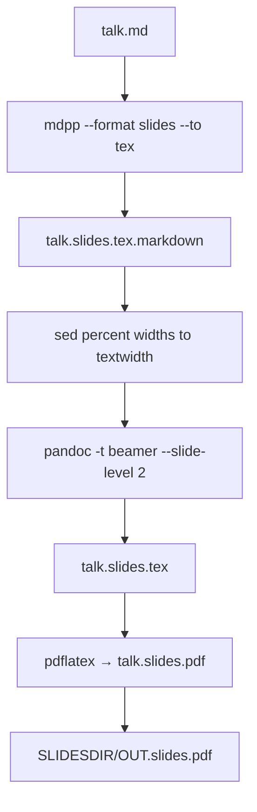

# CIP-0017: Beamer slides PDF from LaMD sources

> **Note**: CIPs describe HOW to achieve requirements (WHAT).
> Use `related_requirements` to link to the requirements this CIP implements.

> **Compression Metadata**: The `compressed` field tracks whether this CIP's key decisions have been compressed into formal documentation. Set to `false` by default.

## Status

- [x] Proposed - Initial idea documented
- [x] Accepted - Approved, ready to start work
- [x] In Progress - Actively being implemented
- [x] Implemented - Work complete, awaiting verification
- [ ] Closed - Verified and complete
- [ ] Rejected - Will not be implemented (add reason, use superseded_by if replaced)
- [ ] Deferred - Postponed (use blocked_by field to indicate blocker)

## Summary

Add a Beamer PDF pipeline for the slides view of a LaMD source, parallel to the existing notes PDF path (CIP-0013). `maketalk --format slides --to pdf` must produce `${BASE}.slides.pdf`. Frontmatter `slidespdf: True` includes that target in `make all`.

Addresses [REQ-0012](../requirements/req0012_slides-pdf.md).

## Motivation

`mdpp --format slides --to tex` already exists, but [`talk-macros-slides-tex.gpp`](../lamd/macros/talk-macros-slides-tex.gpp) is a stub and [`make-tex.mk`](../lamd/makefiles/make-tex.mk) has no slides-PDF rule. `maketalk --format slides --to pdf` therefore requests `${BASE}.slides.pdf` and fails. `maketalk --to pdf` runs `make pdf`, which also has no rule.

Reveal HTML cannot reconstruct archival lecture PDFs. Beamer is in TeX Live, pandoc can write it with `-t beamer --slide-level 2`, and it matches the existing `\newslide` → `## heading` convention. FoilTeX is unmaintained and not a LaMD engine.

## Detailed Description

### Design choices

| Concern | Decision |
|---------|----------|
| Engine | Beamer via pandoc `-t beamer --slide-level 2` |
| Frame source | Keep `\newslide{title}` as markdown `## title` (already in `talk-macros-slides.gpp`); strip Reveal attrs in the TeX override so `{.scrollable}` is not part of the frame title |
| Figures | In slides-tex, `\figure` is a centred non-float (Beamer frames must not float) |
| Flag | Frontmatter `slidespdf: True` (do not overload `pdf:`) |
| CLI | `--format slides --to pdf` → `make ${BASE}.slides.pdf`; `--to pdf` with no `--format` → both `${BASE}.notes.pdf` and `${BASE}.slides.pdf` |
| Copy destination | `${SLIDESDIR}/${OUT}.slides.pdf`, mirroring HTML slides |
| Bibliography | Same as default notes: `--natbib` + bibtex. Citation-free decks still get an empty `.bbl` attempt; follow CIP-0013's exercise guard only if that proves brittle |
| Reveal attrs | No-ops in v1 (`data-background*`, `.font-sm`, `.scrollable`) |
| FoilTeX | Out of scope |

### Pipeline



`mdpp` already sets `-DSLIDES=1 -DTEX=1`, so `talk-macros.gpp` includes `talk-macros-slides.gpp`, `talk-macros-tex.gpp`, and `talk-macros-slides-tex.gpp`. The last file currently only no-ops animation macros. This CIP gives it `\newslide` / `\section` (drop attrs) and a non-float `\figure`.

### Makefile sketch

```makefile
%.slides.tex.markdown: %.md ${DEPS}
	${PP} $< -o $@ --format slides --to tex --code none \
		--snippets-path ${SNIPPETSDIR} --macros-path=$(MACROSDIR) \
		--diagrams-dir ${DIAGRAMSDIR} ${PPFLAGS}
	sed -i -e 's/width=\(.*\)\%/width=0.\1\\textwidth/g' $@
	sed -i -e 's/height=\(.*\)\%/height=0.\1\\textheight/g' $@

${BASE}.slides.tex: ${BASE}.slides.tex.markdown ${TEXDEPS}
	pandoc -s -t beamer --slide-level 2 \
		--natbib ${BIBFLAGS} \
		-B ${INCLUDESDIR}/${NOTATION} \
		-o ${BASE}.slides.tex \
		${BASE}.slides.tex.markdown
	${SCRIPTDIR}/copy_web_diagrams.sh ${VERBOSE:+--verbose} ${BASE}.md texdiagrams \
		${SLIDESDIR}/diagrams ${SLIDESDIR} ${DIAGRAMSDIR} ${SNIPPETSDIR}

${BASE}.slides.pdf: ${BASE}.slides.aux ${BASE}.slides.bbl ${BASE}.slides.tex
	pdflatex -shell-escape ${BASE}.slides.tex
	cp ${BASE}.slides.pdf ${SLIDESDIR}/${OUT}.slides.pdf
```

Create `${SLIDESDIR}` before the copy if needed (existing notes PDF already assumes `${NOTESDIR}` exists).

### Flags and `make all`

- [`flags.py`](../lamd/flags.py) `post`: if `slidespdf`, emit `--metadata slidespdf={out}.slides.pdf`.
- lynguine [`extract_all`](../../lynguine/lynguine/util/talk.py): if `slidespdf`, append `base + '.slides.pdf'` so `DYNAMIC_DEPS` / `make all` builds it.
- Until that lynguine patch is installed, `maketalk --format slides --to pdf` is sufficient.

### CLI dangling targets

Today:

- `--format slides --to pdf` → `make ${base}.slides.pdf` (no rule)
- `--to pdf` → `make pdf` (no rule)
- `--format slides` → `make slides` (no phony target)

This CIP adds the `.slides.pdf` rule. `--to pdf` with no `--format` becomes `make ${base}.notes.pdf ${base}.slides.pdf` rather than `make pdf`. `--format slides` without `--to` stays `make slides`; add a phony `slides` that builds HTML plus PDF when those flags are on only if that is cheap. v1: do not invent a `slides` phony that changes HTML-only modules; the explicit `--to pdf` form is the supported PDF path.

### Out of scope

- FoilTeX / `foils.cls` as a `slides_engine`
- Honouring Reveal backgrounds and font-size classes in Beamer
- Student/lecturer `\answer` variants in notes PDF
- Changing the notes `article` template toward `notes.cls`

## Implementation Plan

1. **Macros** — override `\newslide` / `\section` in `talk-macros-slides-tex.gpp` to emit `## title` without attrs; redefine `\figure` as a centred non-float.
2. **Makefile** — add `.slides.tex.markdown`, `.slides.tex`, `.slides.pdf` rules in `make-tex.mk`.
3. **Flags / CLI** — `slidespdf` metadata; `maketalk --to pdf` maps to notes+slides PDF targets; `--format slides --to pdf` already names the right target once the rule exists.
4. **lynguine** — `extract_all` includes `.slides.pdf` when `slidespdf` is true.
5. **Docs** — `docs/contexts/slides.md` output formats; `slidespdf` in `_lamd.yml` comments where `notespdf` is documented.
6. **Tests** — fixture with `\newslide`, `\slides{}`, `\figure{\includepng{…}}`, math; assert intermediate markdown has `##` headings without Reveal attrs; assert Beamer `.tex` contains `\begin{frame}`; PDF build if pdflatex is available. Unit-test `maketalk --format slides --to pdf` → `make test.slides.pdf`.

## Backward Compatibility

- Default `slidespdf` unset/false: `make all` does not build a slides PDF.
- Reveal HTML, PPTX, notes PDF, and notebooks unchanged.
- Modules that already pass `--format slides --to pdf` start succeeding instead of failing.

## Testing Strategy

- Unit: `maketalk --format slides --to pdf` invokes `make ${base}.slides.pdf`.
- Unit: `maketalk --to pdf` invokes both notes and slides PDF targets.
- Unit: `flags post` emits `slidespdf=` when the field is true.
- Macro: slides-tex `\newslide{Title}{.scrollable}` does not keep `.scrollable` in the heading line.
- Integration: fixture markdown through mdpp + pandoc `-t beamer` contains `\begin{frame}`; pdflatex succeeds when TeX Live is present.

## Related Requirements

- [REQ-0012](../requirements/req0012_slides-pdf.md) — PDF slides from the same source as Reveal HTML.

## Implementation Status

- [x] Draft CIP and REQ-0012
- [x] Accept CIP
- [x] Slides-tex macros (`\newslide`, `\section`, non-float `\figure`)
- [x] `make-tex.mk` slides PDF rules
- [x] `flags.py` + `maketalk.py` CLI
- [x] lynguine `extract_all`
- [x] Fixture tests
- [x] Document `slidespdf` in slides context

## References

- `lamd/makefiles/make-tex.mk` — notes PDF (pattern to copy)
- `lamd/macros/talk-macros-slides.gpp` — `\newslide{text}{commands}` as `##`
- `lamd/macros/talk-macros-slides-tex.gpp` — current stub
- CIP-0013 — notes/exercise PDF template selection
- `docs/contexts/slides.md` — currently lists HTML and PPTX only
